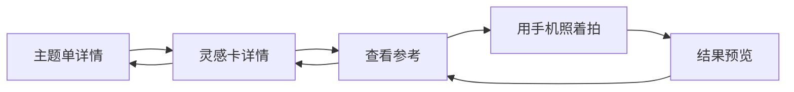

# 出片没｜交互与 C 端体验补充审查 v2

**审查目标**：以移动 H5 / PWA 的首次使用与现场复拍为对象，补充理解成本、主操作、容错、信任与恢复路径。  
**审查对象**：[低保真交互原型 v2](出片没_低保真交互原型_v2.html)；与 [原型审查报告 v1](出片没_原型审查报告_v1.md) 配套阅读。  
**使用框架**：Product Design `$audit` + `consumer-ux` 的消费者端审查规则。

> **视觉审查限制**：本轮已按 `$audit` 尝试在内置浏览器加载原型并采集流程截图；本地 `file:` 与本机回环地址均无法由该浏览器访问，隔离 Chrome 也不可用。因此本文件是基于当前原型源文件与已确认交互规则的**流程补充审查**，不是基于截图的完整视觉/无障碍审查。颜色对比、实际字号、点击热区、滚动遮挡和动效仍需在可访问的预览中复核。

## 结论

核心价值可以在首版讲清：**把平时存下的参考图，在现场迅速找出来照着拍。**

但首版要避免让用户先理解数据结构，再开始使用。现在的主要风险不是字段数量本身，而是“私库、主题单、查看参考、照着拍”四个概念同时出现时，用户可能不知道第一步要点哪里。建议以 **导入一张图 → 直接保存 → 在需要时补标签 / 加入主题单** 作为唯一的首用主线；主题单和相机是后续选择，而不是新手前置任务。

## 主路径逐步检查

| 步骤 | 用户此刻想完成什么 | 健康度 | 关键风险与调整 |
|---|---|---|---|
| 1. 首次进入姿势库 | 开始保存一张参考图 | **需优化** | 首屏只突出「导入灵感」；主题单、筛选与照着拍可见但不抢主操作。空态不要同时要求选主题或填标签。 |
| 2. 导入与快速保存 | 不费脑地把图片收进自己的库 | **阻断** | 当前预填标签容易被误解为 AI 结果，且无 AI 手动编辑链路不完整。默认无标签，保存后再给可跳过的整理入口。 |
| 3. 补充标签 / 拍摄关键词 | 将来能找回这张图 | **阻断** | 需要真正的编辑、保存、取消与草稿保留；「拍摄关键词」必须作为独立自由字段出现。 |
| 4. 建主题单并加入参考 | 为一次出行准备一组图 | **阻断** | 主题内导入后必须回到当前主题单并已加入；从卡片返回也必须保留主题上下文。 |
| 5. 现场筛选与查看参考 | 快速找到适合当下的图 | **需优化** | 筛选条件要保留，结果要说明命中数量；“待整理”不能出现标称数量与空结果不一致。 |
| 6. 只看图 / 开构图线 | 用任何设备或朋友协助拍摄 | **健康** | 「查看参考」先于相机符合任务；构图线默认隐藏且可开关。需补明确返回路径。 |
| 7. 用手机照着拍 | 在手机上叠参考拍摄 | **需优化** | 工具状态要可见；相机拒绝后直接给“继续查看参考”的恢复出口，不把权限拒绝做成死路。 |
| 8. 删除 / 误操作后恢复 | 不丢素材或当前准备进度 | **需优化** | 删除前说清“仅移出主题”与“从私库删除并影响主题引用”的差异；筛选、主题编辑和标签草稿应在返回后恢复。 |

## C 端体验问题与建议

### 1. 理解成本：先让用户做成一件事

| 优先级 | 发现 | 建议交互 | 验收标准 |
|---|---|---|---|
| P0 | 新用户可能把“主题单”误认为必须先建的分类。 | 姿势库空态只提供一个主按钮「导入灵感」；主题单在底部导航中保持可达，但不在首屏和导入流程强绑定。 | 首次用户不创建主题单、不填写标签，也能在 3 步内保存首张图。 |
| P0 | “拍摄关键词”与结构化标签的用途无法从查看态理解。 | 编辑弹层按字段分区：结构化项可选；「拍摄关键词」单列，输入后生成可删除关键词。查看态也保留独立关键词区。 | 用户能把“毕业、游乐园、香水”填进拍摄关键词，而不会误以为要新增分类。 |
| P1 | 相机入口可能暗示必须使用手机拍。 | 详情页以「查看参考」作为主操作；「用手机照着拍」为次级操作。 | 用户不授权相机，也能完成“现场打开参考图”的核心任务。 |

### 2. 主操作：每一步只有一个明显下一步

| 场景 | 主操作 | 次级操作 / 退出 | 不应出现的情况 |
|---|---|---|---|
| 姿势库空态 | 导入灵感 | 进入主题单 | 同一层级放多个等权大按钮。 |
| 导入完成前 | 保存到姿势库 | 添加标签、取消 | 把填写标签设为保存前提。 |
| 灵感卡详情 | 查看参考 | 编辑、加入主题单、删除 | 「用手机照着拍」比查看参考更突出。 |
| 主题单详情 | 添加参考图 | 编辑主题、删除主题 | 直接导入后用户不知图片是否已加入当前主题。 |
| 相机权限被拒绝 | 返回查看参考 | 再次请求相机 | 仅显示技术性权限错误或无出口。 |

**移动端落点**：主按钮固定在拇指易触及的底部安全区；滤镜、关闭和取消始终保留可访问入口，不能只依赖系统返回手势。

### 3. 容错：把轻量录入做成可撤销、可继续

| 风险点 | 推荐规则 | 恢复路径 |
|---|---|---|
| 未填标签就保存 | 允许；卡片记为“待整理”。 | 卡片详情与“待整理”筛选均可继续编辑。 |
| 导入时退出编辑 | 标签、关键词和主题选择暂存为草稿。 | 下次进入导入页提示“继续上次编辑”或静默恢复。 |
| 主题内直接导入 | 保存成功后，图片写入私库并自动加入当前主题单。 | 返回当前主题单，展示新卡片；失败时不创建半成品引用。 |
| 多次点保存 | 保存按钮进入处理中且不可重复提交。 | 成功只生成一张卡；失败保留已填内容，并给重试。 |
| 筛选后打开详情 | 保存筛选条件和列表滚动位置。 | 返回仍在原筛选结果；清除筛选只需一步。 |
| 删除主题中的图片 | 默认是“移出主题”，不删除私库原图。 | 明确“仅移出本主题”；操作后给短暂撤销。 |
| 从私库删除图片 | 明确影响全部主题单引用。 | 二次确认；删除后回到来源页面，并提示已移除的主题数量。 |

### 4. 信任：把数据、权限和能力边界说清楚

| 时机 | 用户需要知道什么 | 推荐呈现 |
|---|---|---|
| 首次导入或“我的”页 | 首版图片与主题数据仅保存在当前设备；清除浏览器数据或换设备可能丢失。 | 紧邻导入/本地数据设置的 info 提示；不在首页长篇说明。 |
| 点击相机前 | 为什么要相机权限，以及不授权仍能做什么。 | 权限请求前的简短原生说明；拒绝后保留查看参考。 |
| 导入 / 标签编辑 | 这不是 AI 自动识别。 | 默认空字段与用户主动输入，避免任何像系统自动标签的预填词。 |
| 删除操作 | 删除的对象和连带影响。 | 行为动词明确区分「移出主题」与「从姿势库删除」。 |
| 未来 AI 功能 | 是否收费、是否上传图片。 | 本 MVP 不出现 AI 入口或付费暗示；二期另行说明，不在首版混入。 |

### 5. 恢复路径：中断后能回到原来的任务

建议原型实现一份显式 `returnTo` / 页面栈状态，最少覆盖下列链路：

- **权限拒绝**：相机页 → 查看参考，不回到首页。
- **系统中断 / 切后台**：重新打开时恢复最后的参考图、构图线状态与主题来源；相机流可安全回到查看参考。
- **无结果**：保留已选筛选条件，提供“清除筛选”而非让用户重新进入列表。
- **本地存储不可用或容量不足**：明确说明“未保存”，保留用户本次标签草稿，并提供重试或取消。

## 本轮应进入原型的修复顺序

1. **P0 数据与返回闭环**：完成 B1、B2、B3，以及“待整理”真实状态（原报告 R1）。
2. **P0 首用与信任边界**：取消导入预填标签（R2）；突出保存而非填写；补本地保存与权限前置说明。
3. **P1 现场操作反馈**：相机工具展示当前状态（R4）；无结果、权限拒绝和返回路径可见。
4. **P1 可发现性**：拍摄关键词分组展示（R3）；参考图缩放使用一次性提示或 info 入口，减少常驻说明（R5）。

## 视觉与无障碍待验证项

待可访问的预览环境准备好后，应以截图和实际点击补验：

1. 主要按钮、图标按钮与底部导航是否在小屏单手场景下有足够热区。
2. 文字、描边、禁用态与选中态的对比度是否足够；不能仅依靠颜色区分相机工具开关。
3. 过滤弹层、编辑弹层与键盘唤起时，保存/取消是否仍可见并可操作。
4. 长主题名、多人穿搭备注、长关键词和空图片是否不会挤压或遮挡主操作。
5. 相机权限拒绝、离线、本地存储失败、重复保存等状态是否能完整走通。
